# Hướng dẫn sử dụng Console Translate · User guide

Tiếng Việt trước, tóm tắt tiếng Anh in nghiêng ở mỗi bước. *Vietnamese first, an English summary in italics under each step.*

**Mục lục · Contents**

1. [Mở app lần đầu](#1-mở-app-lần-đầu--first-launch)
2. [Trang chính](#2-trang-chính--home)
3. [Ghép máy PS5/PS4 (một lần)](#3-ghép-máy-ps5ps4-một-lần--pair-your-console-once)
4. [Chỉnh khung quét](#4-chỉnh-khung-quét--scan-box)
5. [Phụ đề trên TV / OBS](#5-phụ-đề-trên-tv--obs--subtitles-on-tv--obs)
6. [Tùy chỉnh phụ đề và ngôn ngữ](#6-tùy-chỉnh-phụ-đề-và-ngôn-ngữ--subtitle-style-and-languages)
7. [Dịch video web](#7-dịch-video-web--web-video)
8. [Gói Pro](#8-gói-pro--pro)
9. [Mã nguồn và giấy phép](#9-mã-nguồn-và-giấy-phép--source-code-and-licenses)
10. [Gặp lỗi?](#10-gặp-lỗi--troubleshooting)

---

## 1. Mở app lần đầu · First launch

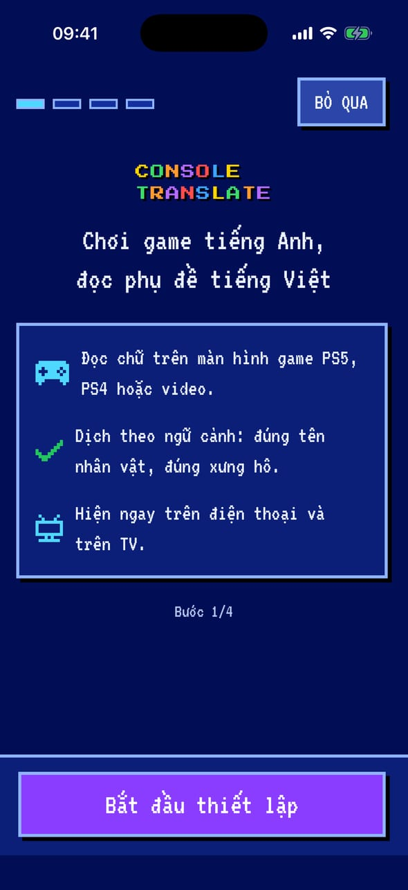

Vài màn giới thiệu ngắn: app đọc chữ trên màn hình game, dịch theo ngữ cảnh và hiện phụ đề trên điện thoại hoặc TV. Bấm **Bắt đầu thiết lập** hoặc **Bỏ qua**.

*A few intro screens explain what the app does. Tap "Start setup" or "Skip".*

## 2. Trang chính · Home

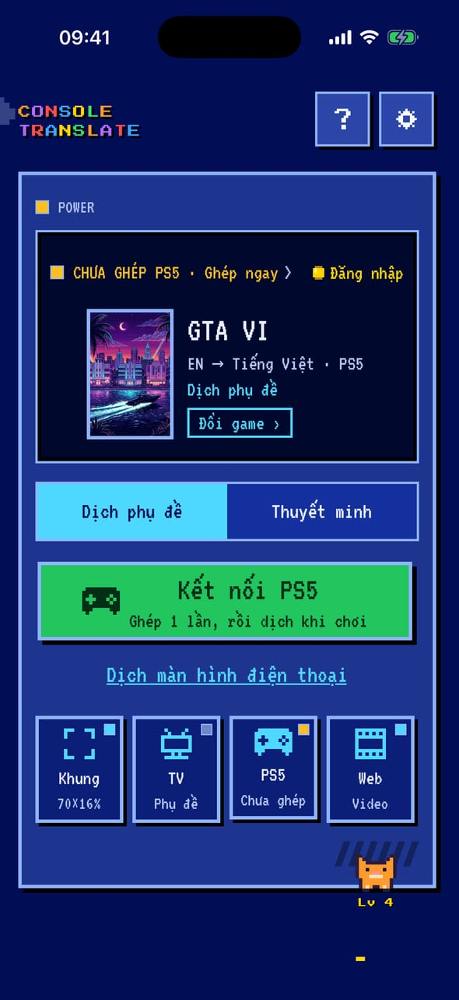

- Dòng trên cùng của màn hình máy cho biết việc cần làm tiếp theo (ví dụ *Chưa ghép PS5 · Ghép ngay*).
- Ảnh bìa và tên game đang chọn; bấm **Đổi game** để chọn game khác. Game có hồ sơ dịch giữ đúng tên nhân vật và cách xưng hô.
- Chọn **Dịch phụ đề** hoặc **Thuyết minh** (giọng AI đọc câu dịch).
- Nút lớn: **Kết nối PS5** (khi đã ghép máy) hoặc **Bắt đầu**. Không có máy? Dùng **Dịch màn hình điện thoại** hoặc thử clip mẫu.
- Bốn phím dưới: Khung quét, TV, PS5, Web.

*The status line says what to do next. Pick the game (games with a profile keep names and forms of address consistent), choose subtitles or narration, then press the big button. Without a console you can translate the phone screen or try the demo clip.*

## 3. Ghép máy PS5/PS4 (một lần) · Pair your console once

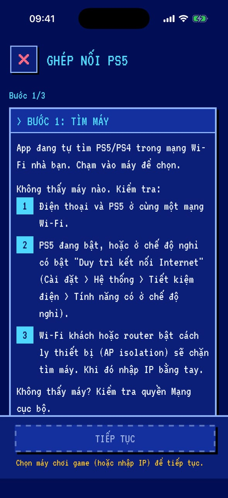

1. **Tìm máy.** Điện thoại và máy chơi game cùng một mạng Wi-Fi. App tự tìm máy trong mạng nhà; chạm vào máy để chọn. Không thấy máy? Kiểm tra máy đang bật (hoặc ở chế độ nghỉ có bật giữ kết nối Internet), Wi-Fi khách / router có chặn thiết bị nói chuyện với nhau không, và quyền Mạng cục bộ của app.
2. **Người chơi.** Chọn tài khoản trên máy sẽ dùng để chơi qua Remote Play.
3. **Mã ghép.** Trên máy: Cài đặt › Hệ thống › Remote Play › *Liên kết thiết bị*, máy hiện mã 8 số. Nhập mã vào app.

Ghép một lần là xong. Hình và tiếng chỉ đi trong mạng nhà bạn, giữa điện thoại và máy của bạn. Khoá ghép máy lưu trên điện thoại, không gửi lên máy chủ.

*Phone and console on the same Wi-Fi. The app finds the console on the LAN; pick it, pick the player account, then enter the 8-digit code the console shows under Settings › System › Remote Play › Link Device. Pairing happens once; video and keys never leave your home network / device.*

## 4. Chỉnh khung quét · Scan box

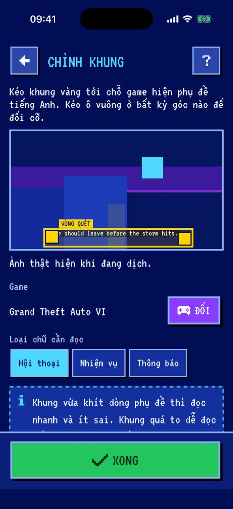

Kéo **khung vàng** trùng vùng phụ đề tiếng Anh của game, kéo các góc để đổi kích thước, chọn loại chữ cần đọc (hội thoại, nhiệm vụ, thông báo) rồi bấm **Xong**. Khung vừa khít dòng chữ thì đọc nhanh và ít sai.

*Drag the yellow box over the game's English subtitle area, resize from the corners, choose the text type, tap Done. A tight box reads faster and more accurately.*

## 5. Phụ đề trên TV / OBS · Subtitles on TV / OBS

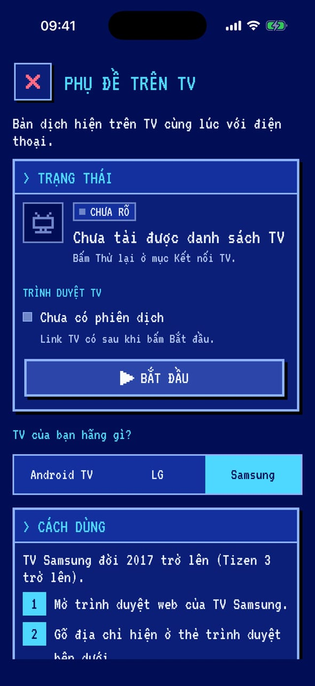

Bản dịch hiện trên TV cùng lúc với điện thoại. Chọn hãng TV (Android TV, LG, Samsung) và làm theo hướng dẫn trong app: mở trình duyệt hoặc app TV và nhập địa chỉ / mã hiện trên điện thoại. Link TV có sau khi bấm Bắt đầu. Người phát trực tiếp có thể thêm link OBS làm *Browser Source*.

*The same subtitles can show on your TV (Android TV app, LG or Samsung browser) or in OBS as a browser source. The link appears once a session has started.*

Chi tiết từng hãng · Per brand: [Android TV và TV khác](TV.md) · [LG](LG.md) · [Samsung](SAMSUNG.md)

## 6. Tùy chỉnh phụ đề và ngôn ngữ · Subtitle style and languages

  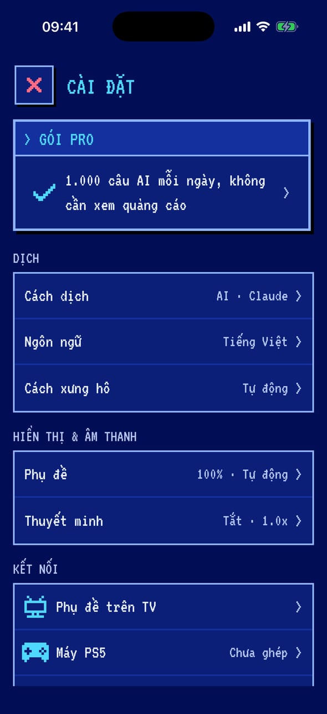
  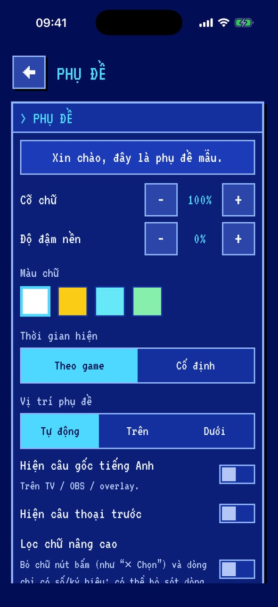
  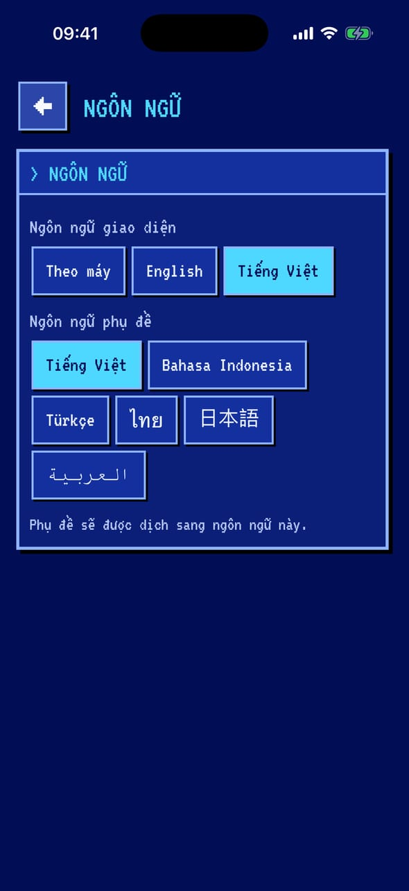

- **Phụ đề:** cỡ chữ, độ đậm nền, màu chữ, thời gian hiện, vị trí, hiện câu gốc tiếng Anh, hiện câu thoại trước.
- **Ngôn ngữ:** giao diện tiếng Việt / English; ngôn ngữ phụ đề: Tiếng Việt, Bahasa Indonesia, Türkçe, ไทย, 日本語, العربية.
- **Cách dịch / Cách xưng hô:** để *Tự động* là đủ cho hầu hết game.

*Change text size, background, color, timing and position; pick the interface language and the subtitle language; leave translation style on Auto for most games.*

## 7. Dịch video web · Web video

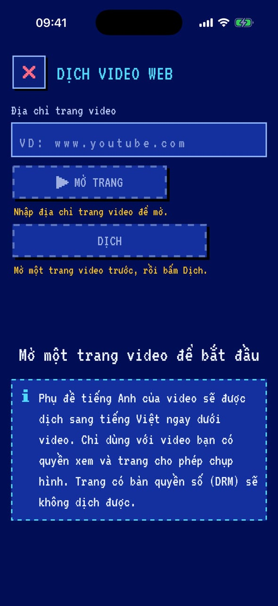

Dán địa chỉ một trang video bạn có quyền xem, bấm **Mở trang** rồi **Dịch**: phụ đề tiếng Anh của video được dịch ngay bên dưới. Trang có bản quyền số (DRM) sẽ không dịch được.

*Paste the address of a video page you are allowed to watch, open it, tap Translate. DRM-protected pages cannot be translated.*

## 8. Gói Pro · Pro

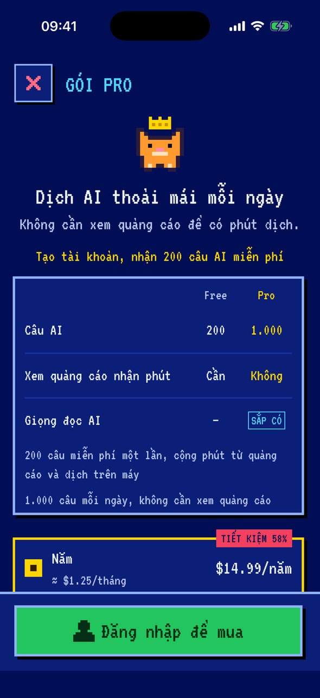

Tài khoản mới được tặng câu dịch AI miễn phí để dùng thử. Gói **Pro** (tuần / tháng / năm) cho nhiều câu AI mỗi ngày, không cần xem quảng cáo. Mua và quản lý gói trong app qua App Store / Google Play.

*New accounts get free AI lines to try the app. Pro (weekly, monthly or yearly) gives many AI lines per day with no ads. Purchases are handled by the App Store / Google Play.*

## 9. Mã nguồn và giấy phép · Source code and licenses

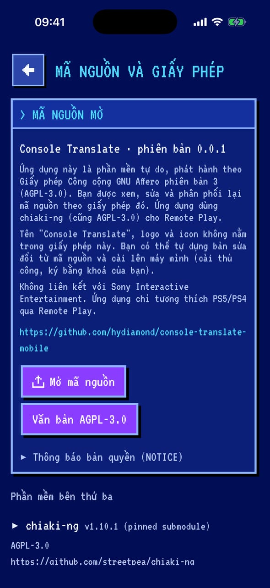

Cài đặt › **Mã nguồn và giấy phép**: thông tin giấy phép (Remote Play dùng chiaki-ng, AGPL-3.0), văn bản AGPL-3.0 và danh sách phần mềm bên thứ ba.

*Settings › Source code and licenses: license information (Remote Play uses chiaki-ng, AGPL-3.0), the AGPL text and the third-party list.*

## 10. Gặp lỗi? · Troubleshooting

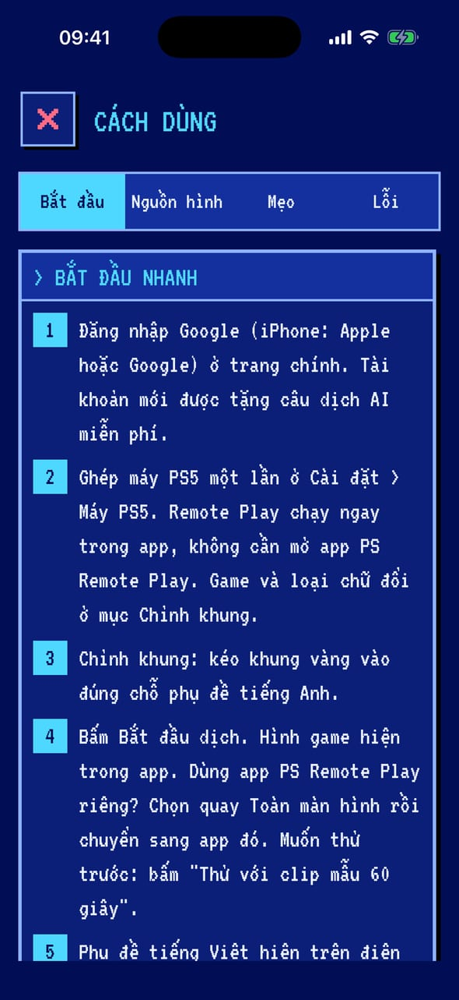

Trong app: nút **?** trên trang chính mở *Cách dùng* (Bắt đầu, Nguồn hình, Mẹo, Lỗi).

| Hiện tượng | Cách xử lý |
|---|---|
| Không thấy máy PS5/PS4 | Cùng Wi-Fi; tắt Wi-Fi khách / AP isolation; bật quyền Mạng cục bộ (iPhone); nhập IP thủ công |
| Phụ đề chậm hoặc sai | Khung quét khít dòng chữ hơn; chọn đúng game; đổi loại chữ |
| Không hiện phụ đề trên TV | Bấm Bắt đầu trước để có link; TV và điện thoại cùng mạng |
| Hết câu dịch AI trong ngày | Chờ sang ngày mới hoặc dùng gói Pro |

*Can't find the console: same Wi-Fi, no guest network / AP isolation, allow Local Network, or enter the IP. Slow or wrong subtitles: tighten the scan box and pick the right game. No TV subtitles: start a session first.*

---

Chính sách quyền riêng tư · Privacy: https://consoletranslate.asia/privacy/ · Điều khoản · Terms: https://consoletranslate.asia/terms/

Console Translate là ứng dụng độc lập, không liên kết với Sony Interactive Entertainment; chỉ tương thích PS5/PS4 Remote Play. *Independent app, not affiliated with Sony Interactive Entertainment.*
