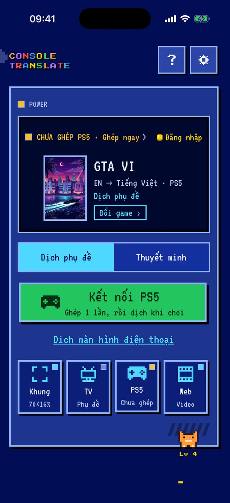
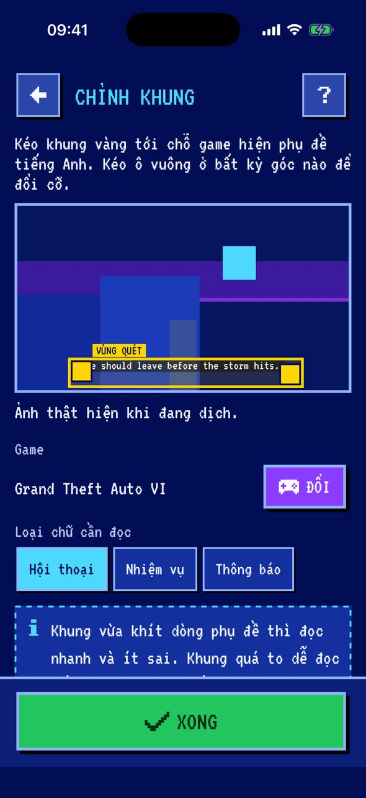
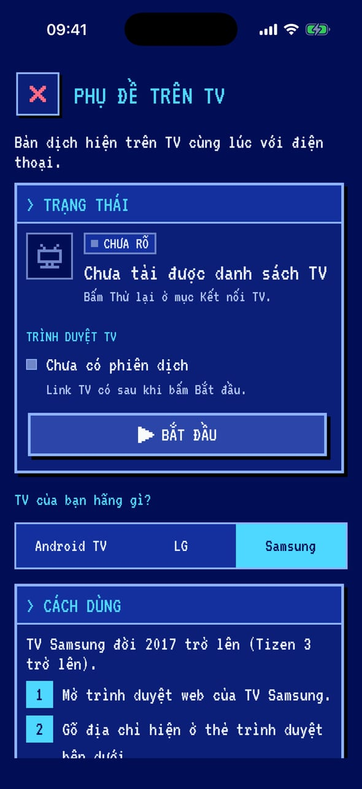
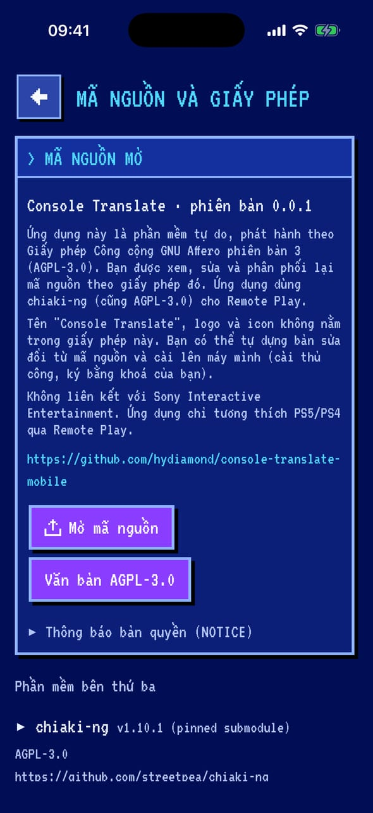

# Console Translate (mobile)

**Play English games, read Vietnamese subtitles.** Console Translate reads the English dialogue on your game screen and shows a translated subtitle right away: on your phone, over your game, and on your TV.

*Chơi game tiếng Anh, đọc phụ đề tiếng Việt.* Ứng dụng đọc câu thoại tiếng Anh trên màn hình game và hiện phụ đề đã dịch ngay trên điện thoại, đè lên game và trên TV.

- Step-by-step guide with screenshots: **[GUIDE.md](GUIDE.md)** (Hướng dẫn từng bước)
- Subtitles on your TV: [TV.md](TV.md) · [LG](LG.md) · [Samsung](SAMSUNG.md)
- Privacy policy: https://consoletranslate.asia/privacy/ · Terms: https://consoletranslate.asia/terms/ · Website: https://consoletranslate.asia/

  
  
  
  

## Features

- **Context-aware translation.** Character names and the right forms of address (anh/em, tao/mày…) follow the scene. Games with a translation profile keep names and terms consistent.
- **Remote Play inside the app.** Pair your own PS5/PS4 once on your home Wi-Fi and play in the app while subtitles appear on top. You can also translate any game or video shown on the phone screen.
- **Subtitles on the TV.** Show the same subtitles on an Android TV, LG or Samsung TV browser, or as an OBS browser source.
- **Narration.** An AI voice can read the translated line aloud.
- **Your style.** Text size, colors, background, position, and how long each line stays.
- **Languages.** Vietnamese, Bahasa Indonesia, Türkçe, ไทย, 日本語, العربية; app interface in Vietnamese and English.
- **Web video.** Translate the English subtitles of a web video you are allowed to watch.

Free accounts get AI translation lines to try the app; **Pro** removes the daily limit for heavy players. See the in-app *Pro* screen for current terms.

## How Remote Play works (for reviewers)

- The app talks only to **a console the user owns**, on **the same local network** (LAN). There is no cloud relay, no NAT hole-punching and no store of consoles or games.
- Pairing is done once by the user, with the PIN that the console itself shows in its Remote Play settings. Console keys and the account ID stay **on the device** (iOS Keychain / Android encrypted storage backed by the Keystore) and are never sent to our server.
- Everything else in the app (translating the phone screen, web video, TV subtitles, settings) works **without a console**. A demo clip lets anyone try the translation flow.
- The translation backend is a separate service; only the recognized text line (and, when needed, a small crop around it) is sent to translate it. See the privacy policy.

## Licenses

Remote Play uses [chiaki-ng](https://github.com/streetpea/chiaki-ng) (AGPL-3.0). The license texts and the list of third-party software are shown in the app under *Settings › Source code and licenses*.

The name "Console Translate", its logo and app icons are trademarks of their owner.

## Disclaimer

Console Translate is an independent app. It is **not affiliated with, endorsed or sponsored by Sony Interactive Entertainment**. It is compatible with PS5/PS4 Remote Play. PlayStation, PS5 and PS4 are trademarks of their owners; game names and artwork belong to their publishers. No game, subscription or extra purchase from the console maker is needed to use the translation features.
