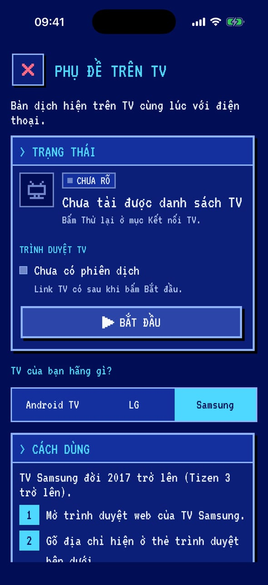

# Phụ đề trên TV · Subtitles on your TV

Bản dịch hiện trên TV cùng lúc với điện thoại, đè lên hình game. Trong app: **trang chính › phím TV** (màn *Phụ đề trên TV*), chọn hãng TV rồi làm theo các bước.

*The translated subtitle shows on your TV at the same time as on the phone. In the app: Home › TV key, pick your TV brand and follow the steps.*

| TV | Cách dùng | Hướng dẫn |
|---|---|---|
| Android TV, Google TV (Android 8 trở lên) | Cài app **Console Translate TV**, phụ đề đè lên cổng HDMI | [Bên dưới](#android-tv--google-tv) |
| LG (webOS) | Trình duyệt của TV, hoặc cài app lên TV từ điện thoại | [LG.md](LG.md) |
| Samsung (Tizen, đời 2017 trở lên) | Trình duyệt của TV, hoặc cài app lên TV từ điện thoại | [SAMSUNG.md](SAMSUNG.md) |
| Hãng khác, Android box | Mở trình duyệt của TV tại địa chỉ `/tv`, phụ đề hiện trên nền đen | [Bên dưới](#tv-hãng-khác-và-obs) |

## Android TV / Google TV

1. Trên TV, tìm **Console Translate TV** trên Google Play, hoặc dùng app *Downloader* với mã hiện trong app điện thoại.
2. Mở app. Khi TV hỏi quyền **Hiện trên ứng dụng khác**, bấm **Cho phép**.
3. TV hiện **mã 8 ký tự** và **mã QR**. Trên điện thoại, nhập mã (hoặc quét QR) ở mục **Kết nối TV**.
4. Chuyển TV sang cổng HDMI của máy chơi game. Mỗi lần bạn bấm **Bắt đầu** trên điện thoại, phụ đề tự hiện trên TV.

**Không thấy quyền "Hiện trên ứng dụng khác"?**

- Vào *Cài đặt › Ứng dụng › Console Translate TV › Hiện trên ứng dụng khác* rồi bật.
- Tắt tối ưu pin cho app, nếu không TV có thể tắt app khi đang ở HDMI.
- Một số TV (như Xiaomi) cần bật thêm quyền *Tự khởi động*.

*Install the Console Translate TV app (Google Play or a Downloader code), allow "display over other apps", enter the 8-character code shown on the TV into the phone, then switch the TV to the console's HDMI input.*

## TV hãng khác và OBS

- **Trình duyệt TV:** bấm **Bắt đầu** trên điện thoại để có link của phiên dịch, bấm **Chia sẻ** ở dòng TV rồi mở link bằng trình duyệt trên TV. Phụ đề hiện trên nền đen.
- **OBS (phát trực tiếp):** thêm **Browser Source** với link OBS trong app (nền trong suốt), đặt lên trên lớp hình game.

*Any TV with a browser can open the session link (subtitles on black). Streamers add the OBS link as a Browser Source with a transparent background.*

## Trạng thái TV trong app

| Trạng thái | Ý nghĩa |
|---|---|
| Chưa ghép | Nhập mã trên TV ở mục Kết nối TV |
| Đang kết nối | TV vừa ghép, vài giây nữa là xong |
| Sẵn sàng | Bấm Bắt đầu, TV tự nhận phụ đề |
| Đang phát | Phụ đề đang đè lên hình game |
| Đang tắt | Bật TV và mở app Console Translate TV |

---

[← Hướng dẫn sử dụng](GUIDE.md) · [README](README.md) · Hỗ trợ: https://consoletranslate.asia/
